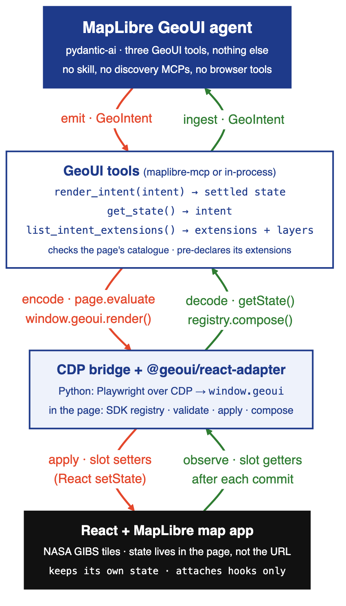
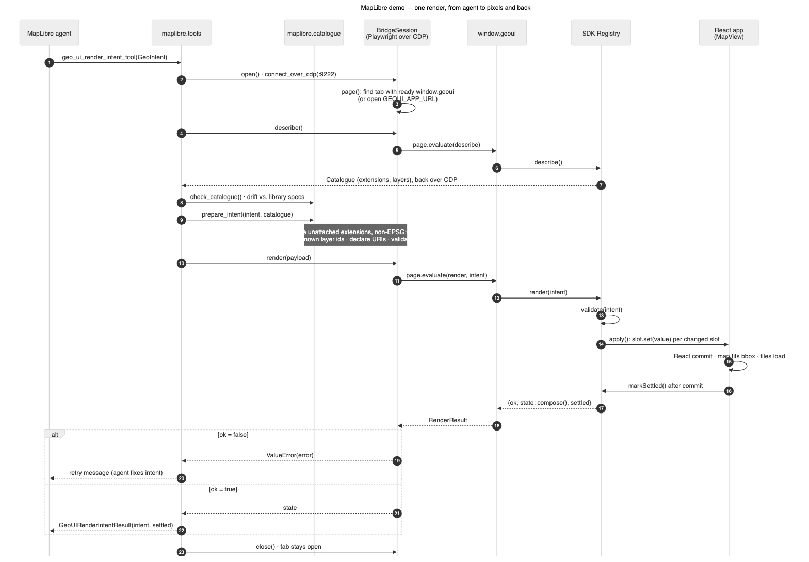

# GeoUI MapLibre demo

The second demo of this repository, built like `demo/worldview`: the Python package in this
directory (`maplibre`, part of the `geoui-demos` workspace member) holds the agent, the tools and
the MCP server, and the application it drives sits beside it under `maplibre_geo_application/`.
Unlike NASA Worldview, nothing here is in the URL.

- `maplibre_geo_application/`: a plain React + TypeScript map (react-map-gl on MapLibre, NASA GIBS
  raster tiles) whose state is attached to the GeoUI Intent Protocol with the
  [`@geoui/react-adapter`](../../sdk/geoui-react-adapter) SDK; it exposes `window.geoui`.
- `cdp.py`: `BridgeSession`, one Playwright `connect_over_cdp` connection that finds the app's tab
  by origin (`GEOUI_APP_URL`) and calls `window.geoui` through `page.evaluate`.
- `catalogue.py`: checks the page's extension catalogue against the library and pre-declares the
  URIs an intent may use (`prepare_intent`).
- `tools/`: the three GeoUI tools as plain functions; `tools/pai.py` is the pydantic-ai toolset.
- `mcp/server.py`: the same three tools as an MCP server, console script `maplibre-mcp`.
- `agents/maplibre_agent.py`: the bare pydantic-ai agent (`build_maplibre_agent`), used by the
  chat notebook (`AGENT=maplibre ./demo/start.sh`) and by `benchmarks/maplibre`.
- `tests/`: unit tests with a fake session, the MCP contract golden under `tests/mcp/fixtures/`.

Nothing here but the agent's prompt is MapLibre-specific: the tools drive any page that exposes
`window.geoui`.

## Architecture

### Block diagram

The agent's GeoUI tools drive the page through a CDP bridge: Playwright calls
`window.geoui.render()`, and the `@geoui/react-adapter` registry in the page validates the intent and
applies it through the app's slot setters. The red arrows are actions; the green arrows read the
composed state back after each React commit.



### Render sequence

One render goes through these steps. The tools `describe()` the page and check its catalogue
against the library, then pre-declare and validate the intent. Next, `page.evaluate(render)` hands
the intent to the SDK registry, which applies each changed slot and waits for the map to settle.
If the result has `ok: false`, the agent gets a retry message.



## Run

```bash
npm install                        # once, at the repo root (npm workspaces)
npm run dev                        # the app at http://127.0.0.1:5173
```

Then either drive it by hand (left panel), from the browser console
(`await geoui.render({layers: [{id: "Coastlines_15m"}], time: {instant: "2025-09-15"}})`), or from an
agent: start Chromium on CDP (`source demo/chromium.sh && ensure_chromium`), open the page in it, and
run the MCP with `GEOUI_APP_URL=http://127.0.0.1:5173 uv run maplibre-mcp`, the agent with
`uv run python -m maplibre.agents.maplibre_agent "Show MODIS Aqua AOD over California on 2025-09-15"`,
or the chat notebook with `AGENT=maplibre ./demo/start.sh`.

## What it attaches

| Protocol field | App state | Notes |
|---|---|---|
| `viewport` | the map's bounds | a render calls `fitBounds` (no animation); the map's own move-end writes the exact bounds back |
| `time` | the selected date | `instant` only; a null (app default) becomes the default date |
| `layers` | the layer stack, bottom first | ids are GIBS layer ids (`src/layers.ts`); opacity maps to `raster-opacity` |
| `compare:*` | swipe between two synced maps | `compare:layers` and `compare:time` for the B side, `compare:value` moves the divider; `spy` and `opacity` modes fall back to swipe |
| `raster-styling:*` | stored and echoed per layer | shown in the layer list; min/max/squash/palettes are not applied to the tiles |

`chart` is not attached, so an agent that asks for it is told so by `window.geoui.render` and by the MCP.

## App layout (`maplibre_geo_application/`)

- `src/App.tsx` owns the state and calls the attach hooks.
- `src/layers.ts` is the catalogue published through `describe()`; `src/gibs.ts` builds tile URLs.
- `src/components/` MapView (one map), CompareSwipe (two maps + divider), Controls (the hand UI), StatePanel (`getState()` live).
