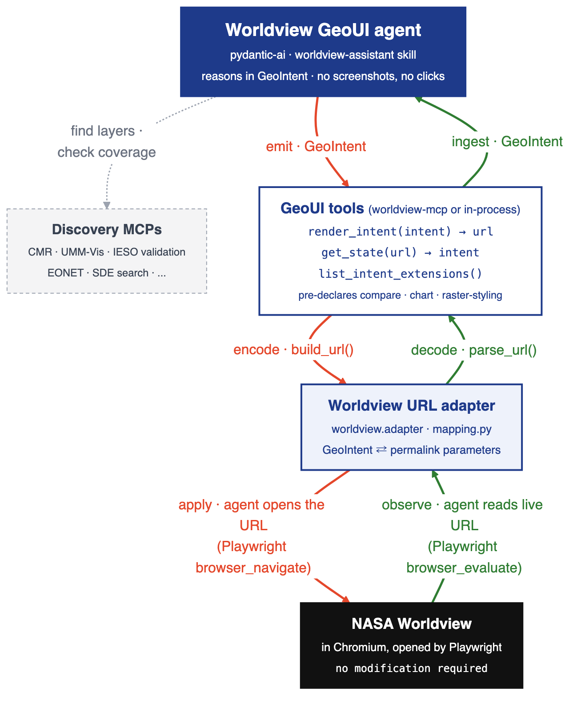
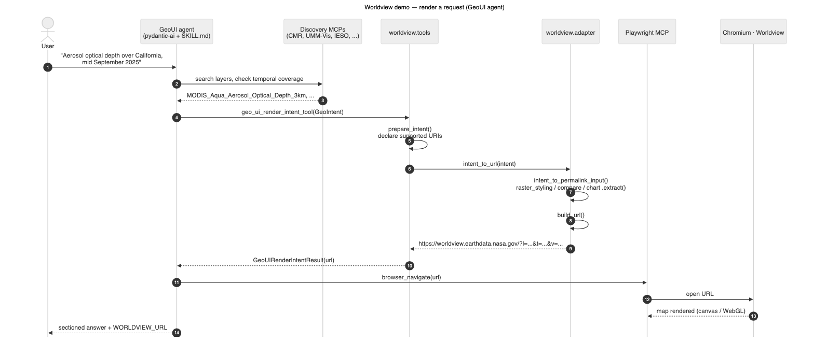
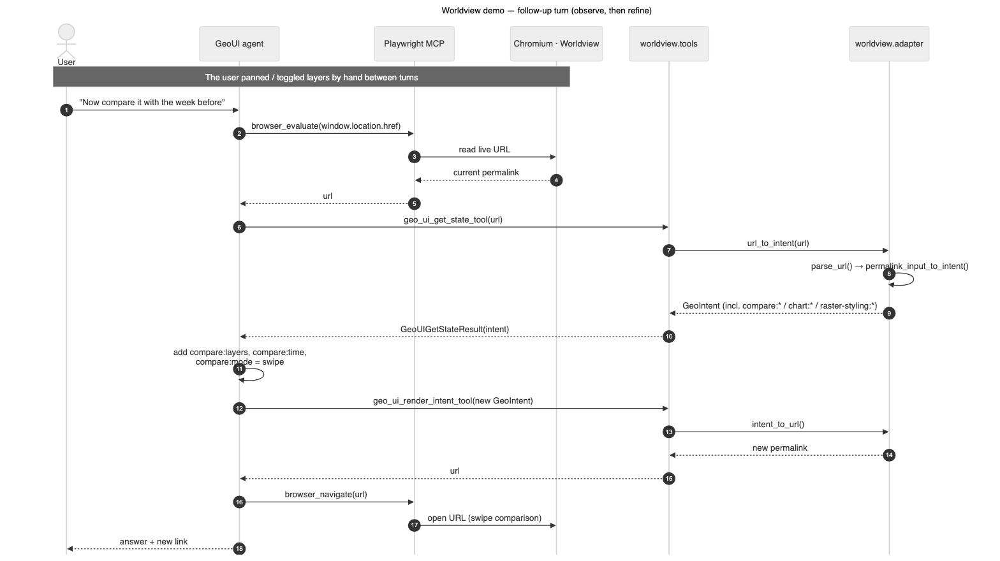
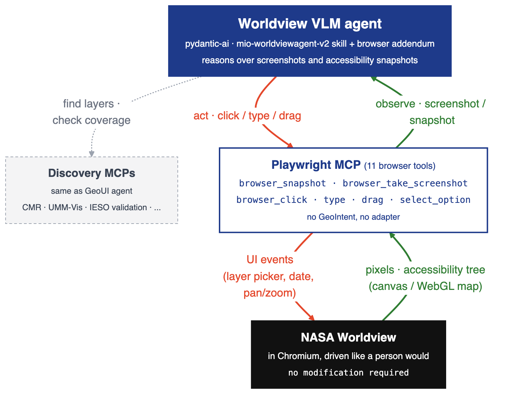
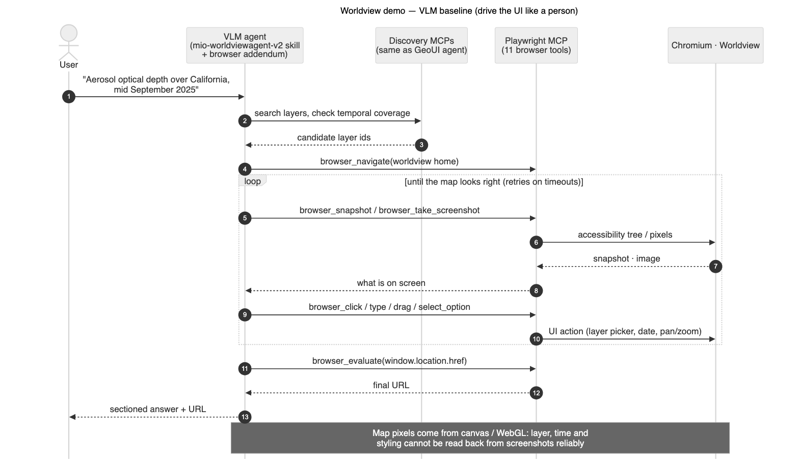

# GeoUI Worldview demo

The reference implementation of the GeoUI Intent Protocol, for NASA Worldview. Worldview keeps its
whole map state in the URL, so the adapter maps a `GeoIntent` to and from a Worldview permalink, and
Worldview itself is never modified. This package (`worldview`, part of the `geoui-demos` workspace
member) holds the adapter, the tools, the MCP server and the two agents that are compared in the
benchmark.

- `adapter/`: `GeoIntent` ⇄ permalink URL (`mapping.py`, `permalink.py`, `url_parser.py`).
- `tools/`: the GeoUI tools (render an intent, get the state, list the intent extensions) as plain
  async functions with request/response models; `tools/pai.py` exposes them, plus `worldview_permalink_tool`, as
  pydantic-ai toolsets.
- `mcp/`: the FastMCP server, console script `worldview-mcp`, with `geo_ui_render_intent_tool`,
  `geo_ui_get_state_tool` and `geo_ui_list_intent_extensions_tool`. Extensions are pre-declared: the
  render tool adds the URIs of the extensions the adapter supports and refuses fields from any other
  namespace.
- `plugin.py`: loads a Claude Code plugin for pydantic-ai: `SKILL.md` as the system prompt,
  `references/` behind `read_reference`, and the `.mcp.json` servers, with `${user_config.*}` filled
  from the environment.
- `agents/`: the GeoUI agent (`geoui_agent.py`) and the VLM + browser-control baseline
  (`vlm_agent.py`), both bare pydantic-ai `Agent`s built from their skills, plus the MCP warm-up
  (`warm_mcps.py`). `agents/artifact/` holds the skill trees: the `akd-plugins` submodule
  (`worldview-assistant`) for the GeoUI agent and the vendored `mio-worldviewagent-v2` for the
  baseline.
- `tests/`: the adapter, tools, MCP contract (golden fixture), plugin loader and agents.

## Architecture

### GeoUI agent

#### Block diagram

The agent reasons in `GeoIntent` only. The GeoUI tools encode it into a permalink through the URL
adapter, and the agent opens that URL in Worldview with Playwright. The observation flow reads the
live URL back and decodes it into a `GeoIntent`. The discovery MCPs are used only to find layers and
check temporal coverage.



#### Render sequence

The first turn: the agent discovers a layer, renders a `GeoIntent` to a permalink and opens it.



#### Get-state sequence

A follow-up turn: the agent reads the live URL back as a `GeoIntent`, adds `compare:*` fields and
renders again.



### VLM baseline agent

#### Block diagram

The baseline has no protocol and no adapter. The agent drives Worldview through eleven Playwright
browser tools and observes it through screenshots and accessibility snapshots.



#### Sequence

The agent loops through snapshot/screenshot → click/type/drag until the map looks right, then reads
the final URL. Worldview draws its map with canvas/WebGL, so the agent cannot reliably recover
layer, time or styling from the pixels.



## Run

From the repository root, after `uv sync`:

```bash
uv run worldview-mcp                              # MCP server over stdio
uv run worldview-mcp --transport http --port 8000 # streamable HTTP at /mcp

cp .env.example .env                              # OPENAI_API_KEY, then the MCP keys you have
./demo/start.sh                                   # GeoUI agent: Chromium + marimo chat
AGENT=vlm ./demo/start.sh                         # VLM + browser-control baseline

uv run pytest demo/worldview/tests                # tests
```

The plugin's discovery MCPs read their keys from `.env` (`VECTOR_DB_TOOL_KEY`, `IESO_MCP_KEY`,
`SDE_MCP_KEY`, `EONET_TOKEN`). A server whose key is unset is skipped with a warning.
