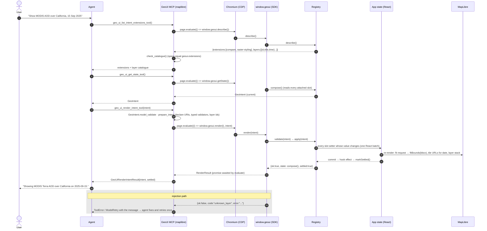
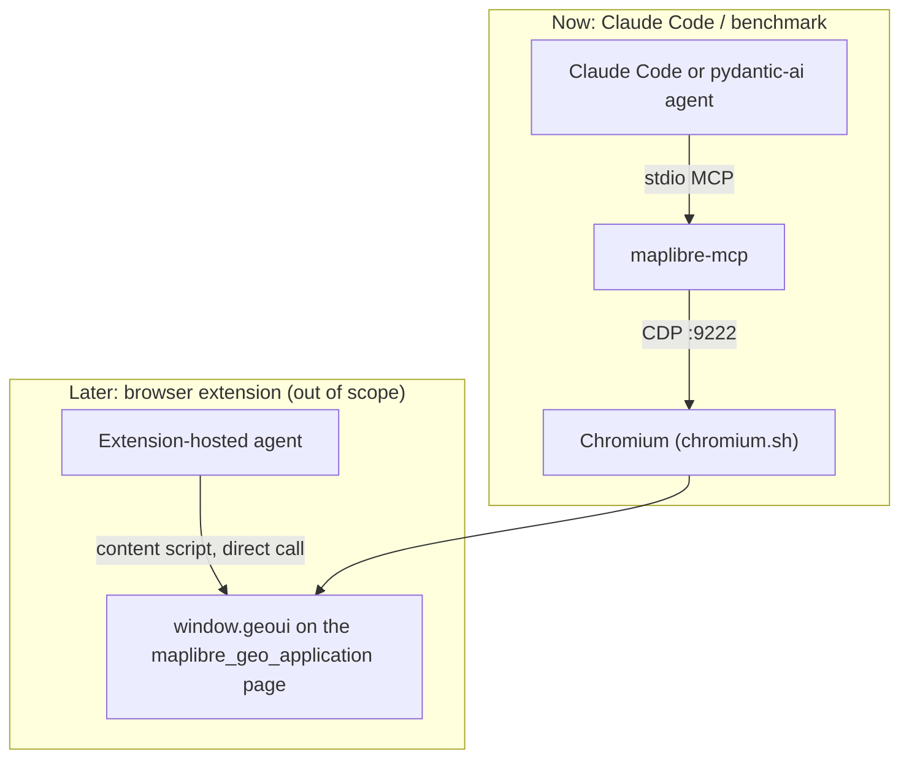

# MapLibre demo architecture: agent to application, end to end

The Worldview demo works because Worldview's state is a permalink: the GeoUI tools compute a URL and
the agent navigates to it. Most visualisation apps have no such URL. The MapLibre demo shows the
protocol working without one: a React app owns its state, the **`@geoui/react` SDK** attaches that
state (read and write) to the protocol, and the **GeoUI MCP in `demo/maplibre/`** (Python package `maplibre`) reaches the running page
over Chrome DevTools Protocol (CDP) to list extensions, read state and render intents. The agent keeps
the same three tools it has for Worldview, so `geouibench` scores it the same way.

Pieces: [`sdk/geoui-react-adapter`](../../sdk/geoui-react-adapter) · [`demo/maplibre`](../../demo/maplibre) (the `maplibre`
package, with the app under `maplibre_geo_application/`) · [`benchmarks/maplibre`](../../benchmarks/maplibre) ·
[`schemas/`](../../schemas) (exported from pydantic by `scripts/export_schemas.py`).

## Component view

Solid arrows carry requests; dotted arrows are build-time or benchmark-only links.

```mermaid
flowchart LR
    subgraph Host["Agent host"]
        U[User] --> A["Agent<br/>(Claude Code via MCP stdio,<br/>or pydantic-ai in-process for the benchmark)"]
    end

    subgraph Bridge["GeoUI MCP · demo/maplibre (package maplibre)"]
        T["tools<br/>geo_ui_list_intent_extensions_tool<br/>geo_ui_get_state_tool<br/>geo_ui_render_intent_tool"]
        C["catalogue.py<br/>check_catalogue · prepare_intent<br/>(geoui.extensions specs + validators)"]
        S["cdp.py BridgeSession<br/>Playwright connect_over_cdp · page.evaluate"]
        T --> C --> S
    end

    subgraph Chromium["Chromium (demo/chromium.sh, --remote-debugging-port 9222)"]
        subgraph Page["maplibre_geo_application page (Vite, React 19)"]
            W["window.geoui<br/>describe() · getState() · render()"]
            R["@geoui/react Registry<br/>slots · compose · validate · apply · settle"]
            P["GeoUIProvider + attach hooks<br/>useGeoUIViewport / Time / Layers / Extension / LayerExtension"]
            ST["App React state<br/>viewState · time · layers · compare · styling"]
            M["react-map-gl / MapLibre<br/>MapView · CompareSwipe"]
            W --> R --> P <--> ST --> M
        end
    end

    G[("NASA GIBS WMTS tiles")]
    A -- "MCP tool calls (JSON)" --> T
    S -- "CDP (HTTP + WebSocket)" --> W
    M -- "tile requests" --> G

    subgraph Bench["geouibench (benchmark only)"]
        B["benchmarks/maplibre/app.py MaplibreApp<br/>snapshot() → geoui+json handle · observe()"]
    end
    B -. "get_state over CDP after each turn" .-> S
    B -. "builds the in-process agent" .-> A

    subgraph Contract["Schema contract"]
        SC["schemas/*.json<br/>exported from pydantic (geoui.core, geoui.extensions)"]
    end
    SC -. "embedded verbatim (gen-types)" .-> R
    SC -. "generated TS types" .-> P
    SC -. "same specs" .-> C
```

## Sequence view: one request, from user to pixels and back

Two things the sequence hides:

- **Pre-declaration happens twice, on purpose.** The page refuses namespaces it did not attach
  (`unsupported_extension`) and the bridge refuses them before the page is even asked, with the same
  wording; the bridge also runs the library's typed validators (`compare.validate`, ...) on the declared
  intent, which the page cannot. Either side alone is a conforming consumer.
- **`settled`.** `render()` resolves after the React commit that applied the setters (every attach hook
  signals commits). An intent that changes nothing settles at once; a setter that never commits times
  out (`settleTimeoutMs`, default 2 s) and reports `settled: false` rather than failing.

## Deployment view: the same page, two hosts

The bridge finds the page by origin (`GEOUI_APP_URL`) and opens it in a new tab through the browser's
own CDP endpoint when none is there, so the tab belongs to the browser and outlives any one Playwright
connection: the in-process toolset connects per call, the MCP server keeps one connection per lifetime,
and `geouibench`'s tab reset between conversations is followed by an automatic reopen.

## Where the state lives, and how the benchmark reads it

| | Worldview | MapLibre |
|---|---|---|
| source of truth | the permalink URL | the app's React state |
| agent → app | render tool returns a URL; the agent navigates to it | render tool writes the state over CDP; nothing to navigate |
| app → agent | get-state tool parses a URL | get-state tool reads `window.geoui.getState()` |
| what the app supports | `worldview.adapter.SUPPORTED_EXTENSIONS` (Python) | whatever the app attached with the hooks (page) |
| benchmark handle (`final_url`) | the URL in the turn's output | `snapshot()` reads the state after the turn: `geoui+json:<GeoIntent>` |
| `observe(handle)` | parse the URL | parse the JSON |

Out of scope for now, listed in the experiment notes: an auto-attaching adapter that scans a global
store at build time, a deck.gl global-state adapter, a browser-extension host, and a patch/merge render
mode (render replaces the whole state, exactly like a permalink).
